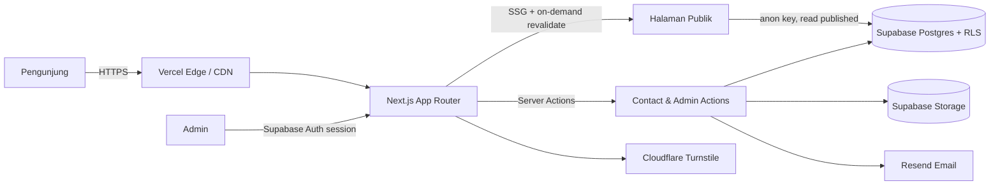
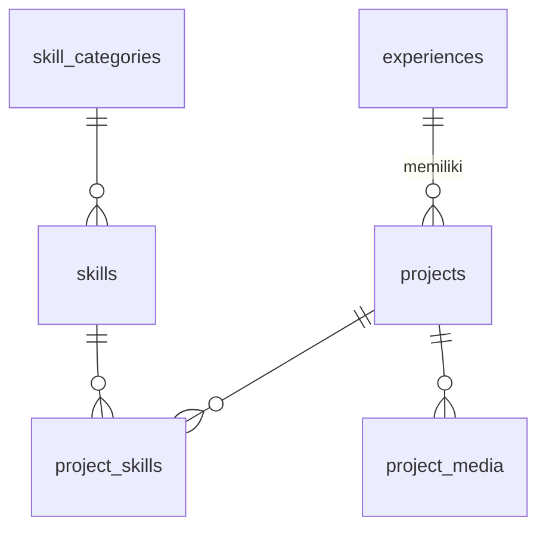

# Product Requirements Document (PRD)
## Website Portfolio Pribadi — Rakhi Azfa Rifansya

| Item | Keterangan |
|---|---|
| **Nama Produk** | rakhiazfa.dev — Personal Portfolio & Case Study Platform |
| **Pemilik Produk** | Rakhi Azfa Rifansya (Full-Stack Developer) |
| **Versi Dokumen** | 1.0 |
| **Status** | Draft — siap direview |
| **Tanggal** | 1 Oktober 2026 |
| **Tech Stack** | Next.js (App Router) + Supabase (Postgres, Auth, Storage) |
| **Hosting** | Vercel (frontend) + Supabase Cloud (backend) |
| **Domain saat ini** | rakhiazfa.vercel.app (akan dimigrasi ke custom domain) |

---

## 1. Ringkasan Eksekutif

Website portfolio ini adalah "etalase profesional" Rakhi Azfa Rifansya, seorang Full-Stack Developer berbasis di Bandung dengan pengalaman 3+ tahun membangun sistem bisnis nyata: sistem manajemen asuransi, booking tiket bus online, e-commerce bakery, CMS enterprise, hingga HRIS perbankan.

Masalah utama CV dalam bentuk PDF adalah informasinya padat namun **tidak bisa menceritakan kedalaman teknis** (arsitektur, trade-off, problem solving). Website ini mengubah 13 proyek di CV menjadi **case study yang terstruktur, dapat dicari, dan mudah dipindai** oleh recruiter maupun engineer, serta dikelola sendiri lewat **admin dashboard** sehingga konten selalu up-to-date tanpa perlu redeploy.

Website ini juga berfungsi sebagai **bukti kompetensi itu sendiri**: dibangun dengan Next.js + Supabase, menerapkan RLS, ISR/on-demand revalidation, dan performa tinggi.

---

## 2. Latar Belakang & Problem Statement

### 2.1 Kondisi Saat Ini
- CV 3 halaman memuat 13 proyek dari 4 perusahaan/klien; recruiter rata-rata hanya memindai CV dalam hitungan detik.
- Sebagian besar proyek adalah **proyek klien/enterprise yang bersifat tertutup** (BCA, Tugu, Prodia, EIGER, Pertamina), sehingga tidak bisa ditunjukkan lewat link live atau source code.
- Skill **Go (Gin, Fiber) dan Microservices** tercantum di CV namun **belum ada satu pun proyek yang membuktikannya** — padahal ini arah karier yang sedang dikejar.
- Website lama (rakhiazfa.vercel.app) kemungkinan statis dan memerlukan edit kode untuk setiap pembaruan konten.

### 2.2 Problem Statement
> "Recruiter dan calon klien tidak dapat dengan cepat memahami kedalaman dan relevansi pengalaman Rakhi, karena bukti kerjanya tersebar, tertutup NDA, dan hanya tersedia dalam format CV statis."

### 2.3 Peluang
- Proyek seperti **Roti Macan** (kanban fulfilment, barcode scanner, quota pickup) dan **Anekatransport** (anti-overbooking, PgBouncer, Redis) adalah cerita teknis yang sangat kuat bila disajikan sebagai case study.
- Section "Lab" dapat menutup gap Go/Microservices dengan side project publik.

---

## 3. Tujuan & Non-Tujuan

### 3.1 Tujuan (Goals)
| ID | Tujuan |
|---|---|
| G1 | Recruiter dapat memahami profil, stack utama, dan pengalaman paling relevan dalam **≤ 30 detik** di halaman utama. |
| G2 | Engineer/tech lead dapat membaca **case study teknis** (masalah → solusi → arsitektur → dampak) untuk minimal 4 proyek unggulan. |
| G3 | Calon klien freelance dapat menghubungi Rakhi melalui **form kontak** yang andal dan terlindungi dari spam. |
| G4 | Rakhi dapat **mengelola seluruh konten** (proyek, pengalaman, skill, CV) lewat admin dashboard tanpa deploy ulang. |
| G5 | Website menjadi **showcase teknis** dengan skor Lighthouse ≥ 90 di semua kategori. |
| G6 | Website ditemukan di Google untuk pencarian nama dan kata kunci "Full-Stack Developer Bandung". |

### 3.2 Non-Tujuan (Non-Goals) untuk v1
- Bukan platform blog lengkap (blog masuk fase 3, opsional).
- Tidak ada sistem komentar, login untuk pengunjung umum, atau fitur sosial.
- Tidak ada e-commerce/pembayaran untuk jasa freelance.
- Tidak menampilkan source code, screenshot asli, atau data sensitif dari proyek klien yang terikat kerahasiaan.

---

## 4. Target Pengguna & Persona

### Persona 1 — Rina, Technical Recruiter (Primer)
- **Konteks:** Menyaring puluhan kandidat per hari, sering membuka portfolio dari LinkedIn di ponsel.
- **Kebutuhan:** Ringkasan cepat, tahun pengalaman, stack, lokasi, status ketersediaan, CV yang bisa diunduh.
- **Frustrasi:** Portfolio yang lambat, berantakan di mobile, atau tidak jelas "orang ini spesialis apa".

### Persona 2 — Dimas, Engineering Manager / Tech Lead (Primer)
- **Konteks:** Menilai kedalaman teknis kandidat sebelum interview.
- **Kebutuhan:** Keputusan arsitektur, cara menangani konkurensi/skalabilitas, kualitas kode (link GitHub), kontribusi spesifik vs. kontribusi tim.
- **Frustrasi:** Portfolio yang hanya berisi daftar logo teknologi tanpa konteks.

### Persona 3 — Pak Hendra, Pemilik UMKM / Calon Klien Freelance (Sekunder)
- **Konteks:** Butuh sistem (toko online, booking, manajemen internal), bukan paham istilah teknis.
- **Kebutuhan:** Contoh hasil nyata yang mirip bisnisnya, cara menghubungi yang mudah (WhatsApp/email).
- **Frustrasi:** Jargon teknis berlebihan.

### Persona 4 — Rakhi, Admin/Pemilik (Internal)
- **Kebutuhan:** Menambah/mengedit proyek, mengganti CV, membaca pesan masuk, mengatur status "Open to Work", semuanya dari satu dashboard.

---

## 5. User Stories

| ID | Sebagai… | Saya ingin… | Agar… | Prioritas |
|---|---|---|---|---|
| US-01 | Recruiter | melihat headline, ringkasan, dan status ketersediaan di hero | langsung tahu kecocokan kandidat | P0 |
| US-02 | Recruiter | mengunduh CV terbaru dalam satu klik | bisa meneruskannya ke user/hiring manager | P0 |
| US-03 | Recruiter | melihat timeline pengalaman kerja | memahami jenjang karier dan durasi | P0 |
| US-04 | Tech Lead | memfilter proyek berdasarkan teknologi (mis. NestJS, Laravel, Spring Boot) | menemukan pengalaman yang relevan dengan stack tim saya | P0 |
| US-05 | Tech Lead | membaca case study dengan diagram arsitektur | menilai cara berpikir teknis kandidat | P0 |
| US-06 | Tech Lead | melihat skill yang terhubung ke proyek yang memakainya | memvalidasi klaim skill dengan bukti | P1 |
| US-07 | Calon Klien | melihat proyek berdasarkan jenis bisnis (e-commerce, booking, CMS) | menemukan contoh yang mirip dengan kebutuhan saya | P1 |
| US-08 | Pengunjung | mengirim pesan lewat form kontak | dapat menghubungi tanpa membuka aplikasi email | P0 |
| US-09 | Pengunjung | beralih bahasa Indonesia ↔ English | membaca dalam bahasa yang nyaman | P1 |
| US-10 | Pengunjung | beralih dark/light mode | nyaman membaca | P1 |
| US-11 | Admin | login aman ke dashboard | hanya saya yang bisa mengubah konten | P0 |
| US-12 | Admin | CRUD proyek, pengalaman, skill | konten selalu mutakhir tanpa redeploy | P0 |
| US-13 | Admin | mengunggah CV PDF baru dan menandainya sebagai aktif | tombol "Download CV" selalu mengarah ke versi terbaru | P0 |
| US-14 | Admin | melihat dan menandai pesan kontak (baru/dibaca/diarsipkan) | tidak ada peluang yang terlewat | P0 |
| US-15 | Admin | menerima notifikasi email saat ada pesan baru | bisa merespons cepat | P1 |
| US-16 | Admin | melihat statistik sederhana (views, download CV, pesan) | mengukur efektivitas portfolio | P2 |

---

## 6. Ruang Lingkup Fitur

### 6.1 Ringkasan Prioritas
- **P0 (MVP, wajib saat launch):** Home, About, Experience, Projects + detail, Skills, Contact, Download CV, Admin CRUD, SEO dasar.
- **P1 (segera setelah launch):** i18n ID/EN, dark mode, filter lanjutan, notifikasi email, OG image dinamis.
- **P2 (fase berikutnya):** Lab/side projects Go, blog/notes, analytics dashboard, testimoni.

### 6.2 Sitemap / Information Architecture

```
/                      → Home (Hero, Highlights, Featured Projects, Stack, CTA)
/about                 → Tentang, pendidikan, nilai kerja, ketersediaan
/experience            → Timeline pengalaman kerja
/projects              → Daftar proyek + filter (stack, kategori, tipe)
/projects/[slug]       → Detail case study
/skills                → Skill matrix (opsional digabung ke /about)
/lab                   → Side projects & eksperimen Go/Microservices (P2)
/blog, /blog/[slug]    → Catatan teknis (P2)
/contact               → Form kontak + kanal alternatif
/admin/*               → Dashboard (terproteksi)
```

Semua rute publik tersedia dalam dua locale: `/id/...` dan `/en/...` (P1). Locale default: `id` untuk pengunjung Indonesia, `en` untuk lainnya (berdasarkan header `Accept-Language`).

---

## 7. Kebutuhan Fungsional

### 7.1 Halaman Home (P0)
| ID | Kebutuhan |
|---|---|
| FR-HOME-01 | Hero menampilkan nama, headline ("Full-Stack Developer"), lokasi (Bandung, Indonesia), ringkasan 1–2 kalimat, dan badge status ketersediaan (*Open to Work / Open for Freelance / Not Available*) yang dapat diatur dari admin. |
| FR-HOME-02 | Dua CTA utama: **"Lihat Proyek"** dan **"Download CV"**. CTA sekunder: ikon LinkedIn, GitHub, Email, WhatsApp. |
| FR-HOME-03 | Section "Highlights" berisi angka kunci yang dapat diedit admin, contoh: *3+ tahun pengalaman*, *13 proyek*, *4 perusahaan/klien*, *5 bahasa pemrograman*. |
| FR-HOME-04 | Section "Featured Projects" menampilkan 3–4 proyek yang ditandai `is_featured`, diurutkan oleh `display_order`. |
| FR-HOME-05 | Section "Tech Stack" berupa grid ikon yang dikelompokkan (Languages, Backend, Frontend, Database, Tools). |
| FR-HOME-06 | CTA penutup mengarah ke halaman Contact. |

### 7.2 Halaman About (P0)
| ID | Kebutuhan |
|---|---|
| FR-ABOUT-01 | Narasi profesional (diperluas dari Professional Summary CV), termasuk fokus saat ini: pendalaman Golang dan arsitektur microservices. |
| FR-ABOUT-02 | Pendidikan: Rekayasa Perangkat Lunak, SMK Balai Perguruan Putri Bandung (2020–2023). |
| FR-ABOUT-03 | Foto profil (dari Supabase Storage) dengan optimasi `next/image`. |
| FR-ABOUT-04 | Bagian "Cara Saya Bekerja" (opsional): kolaborasi lintas tim, requirement gathering, testing — diambil dari poin-poin CV. |

### 7.3 Halaman Experience (P0)
| ID | Kebutuhan |
|---|---|
| FR-EXP-01 | Timeline vertikal berisi perusahaan, jabatan, tipe (Full-time/Freelance/Intern), periode, dan lokasi. |
| FR-EXP-02 | Setiap entri menampilkan daftar proyek di bawahnya yang ter-link ke `/projects/[slug]`. |
| FR-EXP-03 | Durasi dihitung otomatis dari `start_date` dan `end_date` (null = "Sekarang"). |
| FR-EXP-04 | Entri dapat di-expand/collapse untuk menampilkan ringkasan tanggung jawab. |

**Data awal (dari CV):**

| Perusahaan | Jabatan | Tipe | Periode | Proyek |
|---|---|---|---|---|
| PT. Intersolusi Teknologi Asia | Fullstack Developer | Full-time | Jul 2024 – Sekarang | Tugu Clone, Prodia Whitelabel, Rembo Printing, EIGER Affiliate, BCA HRIS |
| CV. Torche Indonesia | Fullstack Developer | Full-time | Jul 2023 – Jul 2024 | Sistem Database Pemasyarakatan |
| Great Website Studio | Fullstack Developer | Freelance | Sep 2022 – Jun 2023 | Roti Macan, Golden Monkey Group, Anekatransport |
| PT. Basicteknologi Intersolusi Tersinergi | Fullstack Developer | Intern | Jul 2022 – Nov 2023* | MyInnovilage, Adhi Persada Beton E-Presence, Pertamina Baubau |

> *Lihat Open Question OQ-01 terkait periode magang.

### 7.4 Halaman Projects (P0)
| ID | Kebutuhan |
|---|---|
| FR-PROJ-01 | Grid kartu proyek: judul, ringkasan satu kalimat, kategori, perusahaan/klien, tahun, dan maksimal 5 badge teknologi. |
| FR-PROJ-02 | Filter berdasarkan **teknologi** (multi-select), **kategori** (E-commerce, Booking, CMS, HRIS, Insurance, Monitoring, dll.), dan **peran** (Built from scratch / Maintenance & Enhancement). |
| FR-PROJ-03 | Pencarian teks pada judul dan ringkasan. |
| FR-PROJ-04 | State filter tersimpan di URL query string (`?stack=nestjs&category=ecommerce`) agar dapat dibagikan. |
| FR-PROJ-05 | Label **"Confidential / Client Project"** pada proyek NDA; tombol live demo & repo disembunyikan otomatis. |
| FR-PROJ-06 | Empty state yang ramah bila filter tidak menghasilkan proyek. |

### 7.5 Halaman Detail Proyek / Case Study (P0)
Struktur konten setiap case study:

1. **Header:** judul, klien/perusahaan, periode, peran, tipe kontribusi, stack.
2. **Konteks & Masalah:** kebutuhan bisnis yang ingin diselesaikan.
3. **Kontribusi Saya:** apa yang dikerjakan Rakhi secara spesifik (dibedakan dari pekerjaan tim).
4. **Solusi & Fitur Kunci:** poin-poin dari CV, diperluas dengan penjelasan.
5. **Arsitektur:** diagram (Mermaid atau gambar SVG buatan sendiri, bukan screenshot klien).
6. **Tantangan Teknis & Keputusan:** trade-off yang diambil.
7. **Hasil/Dampak:** metrik bila ada (mis. waktu respons, jumlah transaksi) — boleh kualitatif bila tidak ada angka.
8. **Navigasi:** proyek sebelumnya/berikutnya dan proyek terkait (berdasarkan stack sama).

| ID | Kebutuhan |
|---|---|
| FR-CASE-01 | Konten case study ditulis dalam **Markdown/MDX** yang disimpan di kolom database dan dirender aman di server. |
| FR-CASE-02 | Mendukung blok Mermaid untuk diagram arsitektur. |
| FR-CASE-03 | Galeri gambar opsional (dari Supabase Storage) dengan lightbox. |
| FR-CASE-04 | Metadata SEO per proyek (title, description, OG image dinamis). |
| FR-CASE-05 | Halaman di-generate statis (SSG) dan di-revalidate on-demand saat admin menyimpan perubahan. |

**Rekomendasi Featured Case Study (v1):**

| Proyek | Alasan Ditonjolkan | Sudut Cerita |
|---|---|---|
| **Roti Macan** | Dibangun end-to-end dari nol, fitur paling kaya | Pickup quota per sesi, kanban fulfilment multi-staf, barcode scanner, BullMQ, Midtrans |
| **Anekatransport** | Masalah konkurensi nyata | Real-time seat inventory, pencegahan overbooking, Redis caching, PgBouncer |
| **Tugu Clone (Insurance)** | Domain enterprise + full-stack | RBAC lintas FE/BE, alur klaim asuransi, FCM real-time notification |
| **BCA HRIS** | Menunjukkan kemampuan Java/Spring | Spring Batch untuk data massal, Master Data Upload/Download, laporan eligibilitas grade |

**Daftar lengkap proyek untuk seed data:**

| Slug | Judul | Kategori | Stack Utama | Tipe | NDA |
|---|---|---|---|---|---|
| `roti-macan` | Roti Macan — E-commerce Bakery | E-commerce | NestJS, Next.js, PostgreSQL, Redis, BullMQ | From scratch | Cek dengan klien |
| `anekatransport` | Anekatransport — Bus Ticket Booking | Booking | Laravel, Nuxt.js, PostgreSQL, Redis, PgBouncer | From scratch | Cek dengan klien |
| `tugu-insurance` | Tugu Clone — Insurance Management | Insurance | Laravel, Vue.js, PostgreSQL, FCM | Development | Ya |
| `bca-hris` | BCA Human Resources Information System | HRIS | Spring Boot, Spring Batch, PostgreSQL | Development | Ya |
| `prodia-cms` | Prodia Whitelabel — CMS | CMS | Vue.js, Pinia, PrimeVue, Tailwind | Development | Ya |
| `rembo-printing` | Rembo Printing — Printing Management | Operations | NestJS, TypeORM, Vue.js, PostgreSQL | Maintenance | Ya |
| `eiger-affiliate` | EIGER Adventure Store Affiliate Program | CMS / Affiliate | PostgreSQL, Selenium | Development | Ya |
| `sistem-database-pemasyarakatan` | Sistem Database Pemasyarakatan | Government / Biometric | Laravel, Lumen, Vue.js, MinIO, SourceAFIS | Development | Ya |
| `golden-monkey` | Golden Monkey — Customer Classification | Analytics / CRM | Laravel, MySQL | From scratch | Cek dengan klien |
| `myinnovilage` | MyInnovilage — Innovation Management | Education | Laravel, MySQL | Development | Cek |
| `adhi-persada-epresence` | Adhi Persada Beton E-Presence | HR / Attendance | Laravel | Maintenance | Ya |
| `pertamina-baubau` | Pertamina Baubau — Vessel Monitoring | Monitoring | Laravel, MySQL | From scratch | Ya |

### 7.6 Skills (P0)
| ID | Kebutuhan |
|---|---|
| FR-SKILL-01 | Skill dikelompokkan sesuai CV: Languages, Backend Frameworks, Frontend, Databases & Storage, Tools & Concepts. |
| FR-SKILL-02 | Setiap skill menampilkan jumlah proyek yang menggunakannya; klik skill → membuka `/projects?stack=<skill>`. |
| FR-SKILL-03 | Skill dapat ditandai `is_learning` (mis. Go, Microservices) untuk ditampilkan sebagai "Currently Exploring". |
| FR-SKILL-04 | **Tidak menggunakan progress bar persentase** (dianggap kurang kredibel); bukti diberikan lewat relasi ke proyek. |

### 7.7 Contact (P0)
| ID | Kebutuhan |
|---|---|
| FR-CON-01 | Form: nama, email, subjek (dropdown: Job Opportunity / Freelance Project / Lainnya), pesan. |
| FR-CON-02 | Validasi client & server dengan Zod (email valid, pesan 10–2000 karakter). |
| FR-CON-03 | Submit melalui **Next.js Server Action** → insert ke tabel `contact_messages` menggunakan service role di server. |
| FR-CON-04 | Proteksi spam: Cloudflare Turnstile + honeypot field + rate limit (maks. 3 pesan per IP per jam). |
| FR-CON-05 | Notifikasi email ke Rakhi saat pesan masuk (P1) melalui Resend atau Supabase Edge Function. |
| FR-CON-06 | Kanal alternatif: tombol WhatsApp (`wa.me/6287817991381`), email, LinkedIn. |
| FR-CON-07 | Pesan sukses/gagal yang jelas; form tidak kehilangan input saat gagal. |

### 7.8 Download CV (P0)
| ID | Kebutuhan |
|---|---|
| FR-CV-01 | Tombol "Download CV" selalu mengarah ke CV yang ditandai `is_active` di tabel `resumes`. |
| FR-CV-02 | File disimpan di bucket publik `resumes` dengan nama file yang konsisten (`CV_Rakhi_Azfa_Rifansya.pdf`). |
| FR-CV-03 | Setiap klik download dicatat sebagai event analytics. |
| FR-CV-04 | Mendukung dua versi CV (ID & EN) sesuai locale aktif (P1). |

### 7.9 Admin Dashboard (P0)
| ID | Kebutuhan |
|---|---|
| FR-ADM-01 | Login via Supabase Auth (email + password atau magic link) dengan **allowlist satu email** admin; pendaftaran publik dinonaktifkan. |
| FR-ADM-02 | Rute `/admin/*` dilindungi middleware Next.js (cek session via `@supabase/ssr`) **dan** RLS di database. |
| FR-ADM-03 | CRUD: Profile/Settings, Experiences, Projects, Skills, Resumes, Messages. |
| FR-ADM-04 | Editor Markdown dengan live preview untuk konten case study. |
| FR-ADM-05 | Upload gambar ke Supabase Storage dengan validasi tipe (jpg, png, webp, svg) dan ukuran (maks. 5 MB). |
| FR-ADM-06 | Drag-and-drop untuk mengatur urutan proyek dan skill (`display_order`). |
| FR-ADM-07 | Status publikasi proyek: `draft` / `published`. Draft tidak tampil di publik. |
| FR-ADM-08 | Setelah simpan, panggil `revalidatePath`/`revalidateTag` agar halaman publik langsung diperbarui. |
| FR-ADM-09 | Inbox pesan dengan status `new` / `read` / `archived` dan badge jumlah pesan baru. |
| FR-ADM-10 | Konten bilingual: form memiliki tab ID dan EN untuk field teks (P1). |

### 7.10 Lab / Side Projects (P2)
| ID | Kebutuhan |
|---|---|
| FR-LAB-01 | Section untuk proyek pribadi yang open source — prioritas: **microservice Go (Gin/Fiber)** dengan Docker, untuk membuktikan skill yang sedang didalami. |
| FR-LAB-02 | Kartu menampilkan status (In Progress / Done), repo GitHub, dan tanggal update terakhir. |
| FR-LAB-03 | (Opsional) Menarik jumlah star & bahasa dari GitHub API dengan cache 24 jam. |

### 7.11 Blog / Notes (P2)
- Catatan teknis singkat (mis. "Mencegah overbooking dengan row-level locking di PostgreSQL").
- Menggunakan tabel `posts`, Markdown, tag, dan RSS feed.

---

## 8. Kebutuhan Non-Fungsional

| Kategori | Kebutuhan | Target |
|---|---|---|
| **Performa** | Core Web Vitals (mobile, 75th percentile) | LCP < 2.5 s, INP < 200 ms, CLS < 0.1 |
| | Lighthouse (Performance, A11y, Best Practices, SEO) | ≥ 90 semua kategori |
| | JS bundle halaman publik (first load) | < 150 KB gzip |
| **SEO** | Metadata API Next.js, `sitemap.xml`, `robots.txt`, canonical URL, `hreflang` ID/EN | Wajib |
| | Structured data JSON-LD: `Person`, `CreativeWork` untuk proyek | Wajib |
| | OG image dinamis per halaman (`next/og`) | P1 |
| **Aksesibilitas** | WCAG 2.1 level AA: kontras, navigasi keyboard, focus ring, alt text, `prefers-reduced-motion` | Wajib |
| **Responsif** | Mobile-first; breakpoint 360 px, 768 px, 1024 px, 1440 px | Wajib |
| **Keamanan** | RLS aktif di seluruh tabel; service role key hanya di server | Wajib |
| | Security headers (CSP, HSTS, X-Frame-Options, Referrer-Policy) | Wajib |
| | Rendering Markdown di-sanitize (rehype-sanitize) | Wajib |
| | Tidak ada data pribadi pengunjung yang ditampilkan publik | Wajib |
| **Ketersediaan** | Uptime (mengikuti SLA Vercel & Supabase) | ≥ 99.5% |
| **Maintainability** | TypeScript strict, ESLint, Prettier, tipe database di-generate dari Supabase CLI | Wajib |
| **Privasi** | Analytics tanpa cookie (Vercel Analytics / Plausible / Umami) | Wajib |
| **Biaya** | Berjalan di free tier Vercel Hobby + Supabase Free | Rp 0/bulan (di luar domain) |

---

## 9. Arsitektur Teknis

### 9.1 Stack

| Layer | Teknologi | Catatan |
|---|---|---|
| Framework | Next.js (App Router, versi stabil terbaru) + TypeScript | Server Components, Server Actions |
| Styling | Tailwind CSS + shadcn/ui | Sesuai stack yang sudah dikuasai |
| Animasi | Motion (Framer Motion) | Hormati `prefers-reduced-motion` |
| Database | Supabase Postgres | RLS di semua tabel |
| Auth | Supabase Auth via `@supabase/ssr` | Hanya untuk admin |
| Storage | Supabase Storage | Bucket: `avatars`, `project-media`, `resumes` |
| Validasi | Zod + React Hook Form | Dipakai bersama client & server |
| i18n | next-intl | Locale `id`, `en` |
| Markdown | `react-markdown` / MDX + `rehype-sanitize` + Shiki (syntax highlight) + Mermaid | |
| Email | Resend (atau Supabase Edge Function) | Notifikasi pesan baru |
| Anti-spam | Cloudflare Turnstile | |
| Analytics | Vercel Analytics + Speed Insights | |
| Testing | Vitest (unit), Playwright (E2E) | |
| CI/CD | GitHub Actions (lint, typecheck, test) + Vercel preview deploy per PR | |

### 9.2 Diagram Arsitektur



### 9.3 Strategi Rendering & Caching
- **Halaman publik:** Static generation dengan data dari Supabase pada build time; cache diberi tag (`projects`, `experiences`, `skills`, `profile`).
- **Saat admin menyimpan:** Server Action memanggil `revalidateTag()` sehingga perubahan tampil dalam hitungan detik tanpa redeploy.
- **Admin dashboard:** Dynamic rendering, tanpa cache.
- **Gambar:** `next/image` dengan remote pattern domain Supabase Storage.

### 9.4 Struktur Folder (usulan)

```
src/
├── app/
│   ├── [locale]/
│   │   ├── (public)/
│   │   │   ├── page.tsx
│   │   │   ├── about/  experience/  projects/[slug]/  contact/  lab/
│   │   └── layout.tsx
│   ├── admin/
│   │   ├── login/  projects/  experiences/  skills/  resumes/  messages/  settings/
│   ├── api/og/route.tsx
│   ├── sitemap.ts
│   └── robots.ts
├── components/        (ui/, sections/, admin/)
├── lib/
│   ├── supabase/      (server.ts, client.ts, middleware.ts)
│   ├── validations/   (zod schemas)
│   └── queries/       (data access per entitas)
├── types/database.ts  (generated)
└── middleware.ts
supabase/
├── migrations/
└── seed.sql           (data awal dari CV)
```

---

## 10. Model Data (Supabase Postgres)

### 10.1 Entity Relationship



### 10.2 Skema Tabel

**`site_settings`** (single row)
| Kolom | Tipe | Keterangan |
|---|---|---|
| id | int PK | Selalu 1 |
| full_name | text | Rakhi Azfa Rifansya |
| headline | jsonb | `{ "id": "...", "en": "..." }` |
| summary | jsonb | Bilingual |
| location | text | Bandung, West Java, Indonesia |
| email, phone, whatsapp | text | |
| linkedin_url, github_url | text | |
| availability | enum | `open_to_work`, `open_freelance`, `not_available` |
| avatar_path | text | Path di Storage |
| highlights | jsonb | Array `{ label, value }` |
| updated_at | timestamptz | |

**`experiences`**
| Kolom | Tipe | Keterangan |
|---|---|---|
| id | uuid PK | |
| company | text | |
| role | text | |
| employment_type | enum | `full_time`, `freelance`, `intern`, `contract` |
| start_date | date | |
| end_date | date null | null = sekarang |
| location | text | |
| description | jsonb | Bilingual |
| display_order | int | |

**`projects`**
| Kolom | Tipe | Keterangan |
|---|---|---|
| id | uuid PK | |
| experience_id | uuid FK null | null untuk side project |
| slug | text unique | |
| title | text | |
| client | text | |
| category | text | |
| contribution_type | enum | `from_scratch`, `development`, `maintenance` |
| summary | jsonb | Bilingual, 1 kalimat |
| content | jsonb | Bilingual, Markdown case study |
| role_description | text | |
| is_confidential | bool | Sembunyikan link & screenshot |
| is_featured | bool | |
| is_lab | bool | Masuk section Lab |
| live_url, repo_url | text null | |
| cover_path | text null | |
| status | enum | `draft`, `published` |
| period_start, period_end | date null | |
| display_order | int | |
| created_at, updated_at | timestamptz | |

**`skill_categories`**: `id`, `name` (jsonb), `display_order`

**`skills`**: `id`, `category_id` FK, `name`, `slug` unique, `icon` (nama ikon/simple-icons), `is_learning` bool, `display_order`

**`project_skills`**: `project_id` FK, `skill_id` FK — PK gabungan

**`project_media`**: `id`, `project_id` FK, `path`, `alt` (jsonb), `caption`, `display_order`

**`resumes`**: `id`, `locale` (`id`/`en`), `file_path`, `is_active` bool, `uploaded_at` — constraint: hanya satu `is_active = true` per locale (partial unique index)

**`contact_messages`**: `id`, `name`, `email`, `subject` enum, `message`, `status` (`new`/`read`/`archived`), `ip_hash`, `user_agent`, `created_at`

**`posts`** (P2): `id`, `slug`, `title`, `excerpt`, `content`, `tags` text[], `status`, `published_at`

### 10.3 Kebijakan Row Level Security (RLS)

| Tabel | anon (publik) | authenticated admin |
|---|---|---|
| site_settings, experiences, skills, skill_categories, project_skills | SELECT | ALL |
| projects, project_media, posts | SELECT jika `status = 'published'` | ALL |
| resumes | SELECT jika `is_active = true` | ALL |
| contact_messages | **Tidak ada akses** (insert via Server Action dengan service role) | SELECT, UPDATE, DELETE |

Admin diidentifikasi melalui fungsi `is_admin()` yang mengecek `auth.jwt() ->> 'email'` terhadap tabel/konfigurasi allowlist, bukan sekadar `auth.role() = 'authenticated'`.

### 10.4 Storage Buckets
| Bucket | Akses | Isi |
|---|---|---|
| `avatars` | Public read, admin write | Foto profil |
| `project-media` | Public read, admin write | Cover, diagram, galeri |
| `resumes` | Public read, admin write | File CV PDF |

---

## 11. Desain & UX

- **Arah visual:** Bersih, "engineer-grade", tipografi kuat; aksen satu warna; dark mode sebagai warga kelas satu.
- **Prinsip konten:** Tunjukkan bukti, bukan klaim. Setiap skill harus terhubung ke proyek; setiap proyek menjelaskan kontribusi pribadi.
- **Hierarki di mobile:** Hero → Download CV → Featured Projects → Contact harus tercapai dalam ≤ 3 scroll.
- **Proyek NDA:** Gunakan ilustrasi diagram arsitektur buatan sendiri dan mockup generik, bukan screenshot asli sistem klien.
- **Motion:** Halus dan fungsional (fade/slide masuk section), dimatikan saat `prefers-reduced-motion`.
- **Komponen inti:** Navbar sticky + language switcher + theme toggle, ProjectCard, TechBadge, Timeline, CaseStudyLayout, ContactForm, AdminDataTable, MarkdownEditor.

---

## 12. Analytics & Metrik Keberhasilan

### 12.1 Event yang Dilacak
| Event | Properti |
|---|---|
| `cv_download` | locale, source_page |
| `contact_submit` | subject |
| `project_view` | slug |
| `outbound_click` | target (linkedin, github, whatsapp, email) |
| `filter_used` | stack, category |

### 12.2 KPI (dievaluasi 3 bulan setelah launch)
| Metrik | Target |
|---|---|
| Rasio download CV terhadap pengunjung unik | ≥ 8% |
| Pesan kontak valid (bukan spam) per bulan | ≥ 3 |
| Rata-rata durasi sesi pada halaman case study | ≥ 1 menit 30 detik |
| Bounce rate halaman Home | ≤ 55% |
| Peringkat Google untuk "Rakhi Azfa Rifansya" | Posisi #1 |
| Pesan spam yang lolos ke inbox | < 5% |

---

## 13. Roadmap & Milestone

| Fase | Durasi | Cakupan | Deliverable |
|---|---|---|---|
| **Fase 0 — Persiapan** | 3 hari | Wireframe low-fi, finalisasi copy, konfirmasi izin NDA, setup repo & Supabase project | Wireframe, `seed.sql`, repo siap |
| **Fase 1 — MVP Publik** | 2 minggu | Home, About, Experience, Projects + filter, 4 case study unggulan, Contact (Turnstile + rate limit), Download CV, SEO dasar | Live di domain baru |
| **Fase 2 — Admin CMS** | 1,5 minggu | Auth admin, CRUD semua entitas, upload media, editor Markdown, revalidation, inbox pesan | Konten dikelola penuh via dashboard |
| **Fase 3 — Enhancement** | 1 minggu | i18n ID/EN, dark mode, OG image dinamis, notifikasi email, sisa 8 case study | Versi 1.1 |
| **Fase 4 — Growth** | Berkelanjutan | Lab (proyek Go microservice), blog/notes, dashboard analytics, testimoni | Versi 1.2+ |

> Urutan alternatif: bila ingin cepat online, Fase 1 boleh membaca data langsung dari `seed.sql` (diedit via Supabase Studio), lalu Fase 2 menambahkan dashboard admin.

---

## 14. Kriteria Penerimaan (Definition of Done untuk v1)

- [ ] Semua halaman P0 tampil benar di Chrome, Safari, Firefox (desktop & mobile).
- [ ] Lighthouse mobile ≥ 90 untuk keempat kategori di Home dan satu halaman case study.
- [ ] Seluruh 12 proyek dari CV tersedia minimal sebagai kartu; 4 proyek unggulan memiliki case study lengkap.
- [ ] Filter proyek berdasarkan stack dan kategori berfungsi dan state-nya tercermin di URL.
- [ ] Form kontak: pesan tersimpan di database, spam (honeypot/Turnstile gagal) ditolak, rate limit aktif.
- [ ] Tombol Download CV mengunduh file aktif terbaru.
- [ ] Pengguna anonim **tidak dapat** membaca `contact_messages` maupun proyek berstatus `draft` (diuji langsung lewat Supabase client dengan anon key).
- [ ] Hanya email admin yang terdaftar yang dapat masuk ke `/admin`.
- [ ] Perubahan konten di admin tampil di halaman publik ≤ 10 detik tanpa redeploy.
- [ ] `sitemap.xml`, `robots.txt`, metadata, dan JSON-LD `Person` valid (diuji dengan Rich Results Test).
- [ ] Tidak ada screenshot, nama internal, atau data sensitif dari proyek berlabel confidential.

---

## 15. Risiko & Mitigasi

| Risiko | Dampak | Mitigasi |
|---|---|---|
| Pelanggaran NDA karena menampilkan detail proyek klien (BCA, Tugu, Prodia, EIGER, Pertamina, sistem pemerintahan) | Tinggi — reputasi & hukum | Flag `is_confidential`; hanya tampilkan deskripsi level tinggi, diagram generik, tanpa screenshot/data asli; konfirmasi ke perusahaan sebelum publish. |
| Klaim skill Go/Microservices tidak didukung bukti proyek | Sedang — kredibilitas di mata tech lead | Tandai sebagai "Currently Exploring" dan prioritaskan satu proyek Lab Go open source. |
| Inkonsistensi data dengan CV/LinkedIn | Sedang — menimbulkan pertanyaan saat interview | Jadikan database portfolio sebagai *single source of truth*, lalu sinkronkan CV & LinkedIn. |
| Spam pada form kontak | Rendah–Sedang | Turnstile, honeypot, rate limit, validasi server. |
| Supabase free tier mem-pause project yang tidak aktif | Sedang — situs error | Halaman publik dirender statis sehingga tetap tampil; tambahkan cron ringan (GitHub Actions) untuk ping berkala. |
| Scope creep (blog, animasi berlebihan) menunda launch | Sedang | Disiplin prioritas P0/P1/P2; launch MVP dulu. |

---

## 16. Pertanyaan Terbuka (Open Questions)

| ID | Pertanyaan | Pemilik |
|---|---|---|
| OQ-01 | Periode magang di PT. Basicteknologi tertulis **Jul 2022 – Nov 2023**, beririsan dengan freelance Great Website Studio (Sep 2022 – Jun 2023) dan CV. Torche (Jul 2023 – Jul 2024). Apakah ini benar paralel, atau seharusnya Nov **2022**? | Rakhi |
| OQ-02 | Proyek mana saja yang sudah mendapat izin untuk ditampilkan secara detail (termasuk nama klien)? | Rakhi |
| OQ-03 | Apakah Roti Macan dan Anekatransport memiliki URL live yang boleh ditautkan? | Rakhi |
| OQ-04 | Custom domain apa yang akan dipakai (mis. `rakhiazfa.dev` / `rakhiazfa.com`)? | Rakhi |
| OQ-05 | Apakah nomor WhatsApp ingin ditampilkan publik, atau cukup tombol `wa.me` tanpa nomor tertulis? | Rakhi |
| OQ-06 | Apakah ada metrik kuantitatif (jumlah pengguna, transaksi, peningkatan performa) yang dapat dipakai di case study? | Rakhi |
| OQ-07 | Fokus target utama: pekerjaan full-time (lokal/remote luar negeri) atau klien freelance? Ini menentukan bahasa default dan urutan konten. | Rakhi |

---

## 17. Lampiran

### A. Pemetaan CV → Konten Website
| Bagian CV | Lokasi di Website |
|---|---|
| Header (nama, kontak, link) | `site_settings` → Hero, Footer, Contact |
| Professional Summary | Hero (versi ringkas) + About (versi panjang) |
| Technical Skills | `skills` + `skill_categories` → Home & Skills |
| Work Experience (perusahaan) | `experiences` → Experience timeline |
| Work Experience (proyek) | `projects` → Projects & case study |
| Education | About |

### B. Glosarium
- **RLS (Row Level Security):** Fitur Postgres untuk membatasi akses baris data berdasarkan identitas pengguna.
- **SSG / ISR:** Static Site Generation / Incremental Static Regeneration — halaman dibangun statis dan diperbarui sesuai kebutuhan.
- **Server Action:** Fungsi server Next.js yang dapat dipanggil langsung dari form tanpa membuat API route terpisah.
- **Case Study:** Narasi proyek yang menjelaskan masalah, solusi, keputusan teknis, dan hasil.